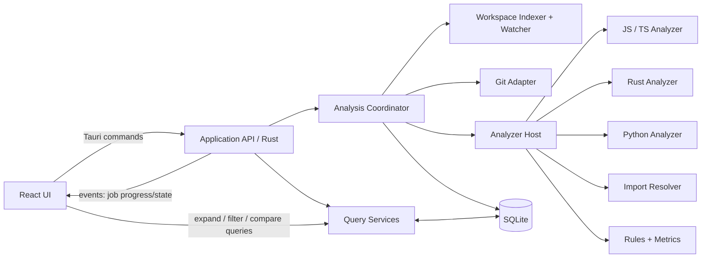

# DEPENDENCY — техническая архитектура

**Статус:** основа для реализации  
**Платформа первой версии:** Windows 10/11  
**Режим:** локальный desktop-инструмент, анализ без выполнения кода проекта

## 1. Архитектурные решения

- Desktop shell: Tauri 2; UI: React + TypeScript; application core и анализ: Rust.
- SQLite — локальное хранилище снимков и результатов. Исходники остаются в репозитории.
- Backend владеет файловой системой, Git, очередью анализа, базой и экспортом. Frontend отображает результаты и хранит только состояние представления.
- Данные анализа имеют снимочную семантику. Новый анализ не портит последний завершённый снимок.
- Граф — многослойная модель (файл, модуль, пакет, символ) с раскрытием по запросу, а не единый обязательный граф всех сущностей.
- Идентичность между снимками — явная связь lineage с уровнем уверенности; постоянный глобальный ID файла не предполагается.

## 2. Контекст и компоненты

### Frontend

Фичи: Overview, Graph, Modules, Packages, Problems, Changes, Reports, Settings. Общие слои: типизированный IPC-клиент, query cache, состояние представления, графовый renderer.

- UI state содержит zoom, layout, фильтры, выделение и раскрытые группы.
- Данные проекта читаются из backend, а не копируются в отдельную клиентскую модель-истину.
- Граф запрашивается страницами/подграфами: `overview`, `expand node`, `node details`, `compare`.
- Canvas/WebGL renderer выбирается после прототипа на крупных реальных графах.

### Rust application core

- **Commands/API:** короткие запросы-ответы; аргументы типизированы, payload ограничен нужной выборкой.
- **Analysis Coordinator:** создание, отмена, прогресс, дедупликация заданий, фиксация готового снимка.
- **Workspace Indexer:** обход файлов, ignore-правила, хеширование, классификация языка, обнаружение конфигураций.
- **Git Adapter:** refs, commits/trees, index, worktree status и staged/unstaged diff.
- **Analyzer Host:** общий контракт анализаторов, ограниченный пул задач и сбор результатов.
- **Import Resolver:** разрешение путей и пакетных ссылок с учётом конфигураций и явным unresolved-результатом.
- **Rules Engine:** циклы, impact, метрики и диагностики с источниками и уверенностью.
- **Query Services:** выборки графа, фильтрация, агрегации, comparisons и экспорт.
- **Integrations:** открытие файла в IDE/Explorer и системные диалоги.

Долгие операции работают вне Tauri command handler. Команды возвращают `job_id`; события Tauri передают только lifecycle/progress и небольшие изменения. Граф и результаты выдаются запросом из backend, не широковещательными событиями.

## 3. Нормализованная модель графа

Узлы имеют `kind`: `file`, `module`, `package`, `symbol`, `directory`, `entry_point`. Рёбра имеют `kind`, `level` и `origin`:

- `file_import`, `reexport`, `type_only_import`, `dynamic_import`;
- `module_depends_on`, `package_depends_on`, `symbol_reference`;
- связи членства `contains` / `declares` между слоями.

Ребро содержит snapshot, source/target, точку происхождения (file + диапазон строк, если есть), resolver status (`resolved`, `unresolved`, `external`, `ambiguous`) и evidence/confidence. Агрегированное ребро каталога/модуля хранит count и ссылку на правило агрегации; исходные рёбра остаются доступными.

Глубина символов и семантики зависит от языка. Неподдерживаемая глубина не имитируется: UI показывает уровень покрытия анализатора.

## 4. Идентичность и сопоставление между снимками

Snapshot-local primary keys не должны переиспользоваться между снимками. Межснимочное соответствие сохраняется отдельно в `entity_lineage`:

`from_snapshot, from_entity, to_snapshot, to_entity, match_kind, confidence, evidence`.

Порядок сопоставления файлов:

1. Тот же нормализованный относительный путь и тот же вид объекта.
2. Сведения Git о rename, если сравниваются Git-деревья или diff их предоставляет.
3. Совпадение содержимого (blob/content hash) для перемещённого/переименованного файла.
4. Кандидаты по языку и структурному fingerprint (exports/symbols), затем ограниченная проверка сходства.
5. Если кандидаты неоднозначны — не сливать сущности: отметить как удаление + добавление и сохранить ambiguous candidate links, если полезно для UI.

Rename — вывод сравнения, а не неизменяемое свойство файла. Git обнаруживает rename по similarity threshold, поэтому результат хранит источник и порог/уверенность, а не представляет его как абсолютную идентичность. Один исходный файл не может автоматически сопоставиться сразу с несколькими целями; копирование отражается отдельным отношением.

Для модулей сопоставлять идентичность контейнера и состав файлов. Для символов использовать языкоспецифичный canonical key (имя/namespace/сигнатура и родительский модуль), затем AST fingerprint. Переименование символа — lineage между разными ключами с evidence; одинаковое имя само по себе недостаточно. Изменение пути файла не должно автоматически менять lineage вложенных символов, если сопоставление файла надёжно.

При сравнении хранятся метки `added`, `removed`, `modified`, `renamed`, `moved`, `unchanged`, `ambiguous`. Изменение тела символа и перемещение файла — независимые аспекты сравнения.

## 5. Git и файловые состояния

Git Adapter различает источники содержимого:

| Состояние | Источник |
|---|---|
| Commit / branch | Git tree выбранного commit SHA; branch разрешается в SHA на момент запуска |
| Staged | index относительно HEAD, включая содержимое blob из index |
| Unstaged | worktree относительно index |
| Рабочий каталог целиком | фактическое содержимое worktree: staged + unstaged изменения и untracked |

Каждый анализ фиксирует свой `basis_kind`, commit SHA (если применимо), index fingerprint, worktree generation/fingerprint и timestamp начала/окончания. Это не даёт выдавать изменчивый `HEAD` или имя ветки за содержимое снимка.

### Untracked

- По умолчанию untracked, не игнорируемые Git файлы входят в `working_tree` snapshot и обычное сканирование каталога.
- Ignored исключаются по умолчанию, но доступны через явную настройку; DEPENDENCY не меняет `.gitignore` и index.
- Индексатор перечисляет файлы файловой системы, а Git Adapter классифицирует их как tracked / staged-new / untracked / ignored / conflicted. Нельзя полагаться только на список tracked Git-файлов.
- Не добавленные в Git файлы анализируются по текущему содержимому; у них нет commit/blob identity, поэтому межснимочная идентичность строится по path/hash/fingerprint.
- Режим анализа коммита не подмешивает untracked из worktree. Режим рабочего каталога включает их явно.
- UI отдельно показывает coverage и количество пропусков/ошибок доступа, чтобы отсутствие файла в графе было объяснимо.

Untracked enumeration может быть дорогой на больших деревьях; обход делать отменяемым, с progress, ignore-фильтрами и watcher cache. Любое ускорение обязано сохранять корректность после invalidation.

## 6. Большие графы и постепенное раскрытие

Frontend не загружает весь граф автоматически. Начальный запрос возвращает корневую группировку и агрегированные связи. `expand(node_id, depth, filters, limit, cursor)` загружает непосредственных детей, `get_node_details` — панели свойств, а символьный уровень подгружается по запросу.

- Группировки: каталоги, модули, пакеты, пользовательские архитектурные группы.
- Схлопнутые группы сохраняют число узлов/рёбер и статусы проблем.
- Поиск возвращает узлы и путь раскрытия к ним.
- Подграф и Impact Analysis ограничиваются фильтрами/глубиной и могут иметь отмену.
- Layout и позиция узлов — данные представления, отдельно от снимка анализа.
- Агрегации кэшируются по snapshot + grouping + filters; инвалидация при новом снимке.

Планировщик запросов должен иметь жёсткие лимиты ответа и отмену. Никакого скрытого лимита общего числа узлов проекта: ограничения относятся к размеру конкретной выборки UI.

## 7. SQLite: схема первого поколения

Общие поля: `project_id`, `snapshot_id`, `created_at`, `schema_version`. Идентификаторы сущностей снимочные; пути хранятся в нормализованном виде относительно root, для Windows сравнение путей учитывает правила регистра файловой системы, сохраняя исходное написание.

Таблицы:

- `projects(id, root_path, settings_json, created_at)`
- `snapshots(id, project_id, basis_kind, head_sha, branch_name, index_fingerprint, worktree_fingerprint, analyzer_version, status, started_at, completed_at)`
- `files(id, snapshot_id, relative_path, language, file_kind, git_state, content_hash, size, mtime, parse_status)`
- `nodes(id, snapshot_id, kind, stable_key, label, file_id, attributes_json)`
- `edges(id, snapshot_id, level, kind, source_node_id, target_node_id, origin_file_id, start_line, start_col, end_line, end_col, resolution_status, confidence)`
- `entity_lineage(id, from_snapshot_id, from_node_id, to_snapshot_id, to_node_id, match_kind, confidence, evidence_json)`
- `diagnostics(id, snapshot_id, rule_id, severity, confidence, node_id, edge_id, location, evidence_json, message_key)`
- `metrics(snapshot_id, scope_node_id, metric_key, numeric_value, evidence_json)`
- `comparisons(id, project_id, base_snapshot_id, target_snapshot_id, options_json, status)`
- `comparison_items(comparison_id, entity_kind, base_node_id, target_node_id, change_kind, confidence, evidence_json)`
- `analysis_jobs(id, project_id, snapshot_id, status, phase, progress, error_json)`
- `graph_layouts(project_id, snapshot_id, grouping_key, layout_json)`

Индексы: edges по `(snapshot_id, source_node_id)` и `(snapshot_id, target_node_id)`; nodes по `(snapshot_id, kind, stable_key)` и `(snapshot_id, file_id)`; files по `(snapshot_id, relative_path)`; diagnostics по `(snapshot_id, severity, node_id)`; lineage по обеим сторонам.

Версии анализатора и схемы фиксируются, чтобы повторный запуск/сравнение не путали результаты разных правил. Внешние ключи включаются на каждом соединении. Для читателей UI параллельно с фоновой записью допустим SQLite WAL; запись снимка выполняется транзакционно, новый snapshot становится `ready` атомарно после завершения.

## 8. Анализ и инкрементальность

Первичный pipeline: определить Git/worktree basis → перечислить файлы → классифицировать состояния/языки → хешировать → переиспользовать факты неизменённых файлов → запустить анализаторы → разрешить imports → сформировать узлы/рёбра → выполнить rules → сопоставить lineage → зафиксировать snapshot.

Изменённые файлы не единственный повод обновить связи: изменение `tsconfig`, manifest-файла, alias или package metadata инвалидирует соответствующую область resolution. Удаление, rename и новый untracked файл должны менять множество кандидатов и тоже запускать пересопоставление. Первый релиз может пересчитывать resolver/rules на уровне проекта после file-level parse cache — проще и надёжнее; сужать пересчёт можно после измерений.

Watcher события объединяются debounce-окном и инвалидируются после переполнения/потери событий, после чего выполняется полная сверка метаданных. Ручной rescan остаётся доступен. Незавершённый/отменённый анализ не становится текущим готовым snapshot.

## 9. IPC и контракты

Команды: `open_project`, `start_analysis`, `cancel_analysis`, `list_snapshots`, `get_overview`, `get_graph_overview`, `expand_graph_node`, `get_node_details`, `get_impact`, `compare_snapshots`, `get_diagnostics`, `export_report`, `open_path`.

События: `analysis:progress`, `analysis:warning`, `analysis:completed`, `analysis:failed`, `workspace:changed`. Все содержат `project_id`, `job_id`/`snapshot_id` и версию схемы payload. События — уведомления; UI при reconnect или пропуске события перечитывает состояние командой.

## 10. Безопасность и приватность

- Никогда не запускать исследуемый код, lifecycle hooks или project scripts.
- Git чтение ограничить безопасными операциями и путями проекта; не собирать shell-команду конкатенацией пользовательских строк.
- Сетевой доступ отключён по умолчанию; обновление сведений о пакетах — отдельная opt-in функция.
- Tauri capabilities выдавать по принципу минимальных прав. UI не получает произвольный filesystem access.
- Защититься от symlink обходов и path traversal; сохранять относительные пути и проверять принадлежность root перед открытием файла.
- Ошибки доступа и неподдерживаемые конструкции показывать как coverage diagnostics.

## 11. Подготовка реализации

Первый вертикальный срез:

1. Инициализировать Tauri/React/Rust workspace и миграции SQLite.
2. Реализовать `open_project`, безопасный filesystem index, список файлов и анализ-job lifecycle.
3. Добавить JS/TS analyzer и file-level imports с разрешением базовых относительных путей и package dependencies.
4. Построить запрос overview/expand, отобразить сгруппированный граф и module inspector.
5. Добавить snapshot basis `working_tree`, включая untracked, затем Git status/diff для staged и unstaged.
6. Реализовать lineage файлов с Git rename evidence, hashes и ambiguity handling; далее lineage модулей и символов.
7. Добавить циклы, impact, сравнение и watch mode.
8. Добавить Rust и Python analyzer adapters через тот же контракт.

Не вводить отдельный микросервис, сервер, plugin process sandbox или абстрактную систему произвольных плагинов на старте. Общий Rust trait достаточен; внешний процесс понадобится только если конкретный анализатор потребует изоляции или отдельного runtime.

## 12. Технически проверенные оговорки

- Tauri IPC подходит для типизированных запросов и lifecycle-событий; большие payload передаются запросами, а не событиями.
- Git rename detection основан на similarity и настраиваемом пороге. Поэтому lineage хранит evidence/confidence, а не полагается на «вечный ID файла».
- Untracked-файлы — часть файловой системы, не Git tree/index. Рабочий snapshot требует filesystem enumeration; Git status помогает классифицировать файлы, но не заменяет сканирование.
- SQLite WAL повышает одновременность читателей/писателя, но создаёт `-wal`/`-shm` состояние, которое нужно учитывать при закрытии и резервном копировании.

Источники: [Tauri IPC](https://v2.tauri.app/concept/inter-process-communication/), [Git diff rename detection](https://git-scm.com/docs/git-diff), [Git status и untracked](https://git-scm.com/docs/git-status), [SQLite WAL](https://www.sqlite.org/wal.html), [SQLite foreign keys](https://www.sqlite.org/foreignkeys.html), [Tree-sitter parsers](https://tree-sitter.github.io/tree-sitter/using-parsers/).
